# Melrose traffic stops map — technical spec

- **Status:** Approved by Ken Hoffmann, 2026-10-07. Revised the same day during phase 1: build details, experiment E9, and requirements feedback A7–A8, which Ken answered the same day. Revised again during phase 2: placement details, experiment E10, Appendix C rules 1–4, and requirements feedback A9, which Ken answered the same day. Phase 2 gate passed, Ken Hoffmann, 2026-10-07: AC2 at 99.7%, AC3's 20-entry sample (seed 2026) and the boundary streets accepted, closing Q2. Revised again during phase 3, 2026-10-08: export and page details, experiment E11, the AC10 word test (Requirements coverage), and requirements feedback A10–A11, which Ken answered the same day. Phase 3 gate passed, Ken Hoffmann, 2026-10-08: AC4 (one week against its PDF), AC6 (7 labelled wards, boundary markers list every ward), AC9 (5 marker links open the page holding the call number) and AC10 on screen (26-11115 and 26-11116 show only `744 LYNN FELLS PKWY`) checked by hand, the amended AC10 word test accepted, and the automated checks (pytest, vitest, pyright, import contracts) passing. Revised after v1, 2026-10-08: requirements feedback A12–A13, changes Ken asked for and answered the same day, and experiment E12.
- **Date:** 2026-10-03, revised 2026-10-07 and 2026-10-08
- **Author:** Ken Hoffmann
- **Requirements:** [design.md](design.md), owner Ken Hoffmann, approved 2026-10-03 and amended the same day with A1–A6 from this spec (see [Requirements feedback](#requirements-feedback)). Read as amended, 2026-10-03.

**Contents**

- [Problem statement](#problem-statement)
- [Approach](#approach)
- [Rollout](#rollout)
- [Risks](#risks)
- [Requirements baseline](#requirements-baseline)
- [Requirements coverage](#requirements-coverage)
- [Architecture](#architecture)
- [Decisions](#decisions)
- [Repos affected](#repos-affected)
- [Data model](#data-model)
- [Interfaces](#interfaces)
- [External sources](#external-sources)
- [Technologies and dependencies](#technologies-and-dependencies)
- [Infrastructure and cost](#infrastructure-and-cost)
- [Security and privacy](#security-and-privacy)
- [Keeping it running](#keeping-it-running)
- [Requirements feedback](#requirements-feedback)
- [Open questions](#open-questions)
- [Docs to update](#docs-to-update)
- [Appendix A: experiments](#appendix-a-experiments)
- [Appendix B: external sources](#appendix-b-external-sources)
- [Appendix C: placement rules](#appendix-c-placement-rules)
- [Appendix D: storage and export formats](#appendix-d-storage-and-export-formats)

## Problem statement

The Melrose Police Department publishes its dispatch log every week as a PDF. The log is public, but in that form nobody can see where traffic stops happen, whether they track where crashes happen, or how they are spread across the city's seven wards. The suspicion being tested is that most stops fall on a few specific streets. Findings may be shown to Melrose officials as evidence, and a public version is planned, so every figure has to trace back to the department's own records and nothing shown may be unfit for public view. When this is done, the author can answer the design's questions (where stops focus, how they line up with crashes, whether wards are policed equally) for any collected date range, from a map, a street ranking and a ward table, without opening the source logs.

## Approach

A Python command-line tool, `cities`, is run by hand; its `melrose` subcommands cover this city. It lists the department's dispatch-log PDFs through the site's WordPress media API and downloads any it hasn't seen. It keeps each PDF exactly as published and parses the entries into SQLite. It then places each entry offline, against dated snapshots of MassGIS address points, MassDOT road centrelines and the MassGIS 2022 ward boundaries. Python decides how every entry is counted: its point, the street(s) it counts toward, and the ward(s) it counts toward. A config file, `categories.toml`, groups call types into the categories the map shows: Stops, and Crashes (three call types). An export step writes only those categories' entries, and only the fields that may be displayed, to a static JSON file. A static page built with TypeScript, Vite and Leaflet loads that file, draws the map on OpenStreetMap tiles, and does all filtering and counting in the browser.

The Python side is built as ports and adapters (T16). The counting, versioning and privacy rules live in a core that imports no PDF, geometry, HTTP or database library, and each outside system sits behind a port named for its purpose.

Everything runs on the author's Mac at no cost. No server or database needs to be hosted, so later public hosting means uploading the built `site/dist/` folder to any static host. SQLite stays wherever the collector runs.

## Rollout

| Phase | Delivers | Gate (can fail) |
|---|---|---|
| 1 | Package skeleton (domain, ports, core, stubs, composition) with the import-linter contracts and port tests; `fetch-reference`, `collect` through parse, `rebuild`, pytest fixtures | [AC1](design.md#ac1) (Sep 21–27 entry count and fields match the PDF) passes. Every document since Jul 20 passes the completeness check, with none quarantined. `lint-imports` and pyright pass. **If it fails:** extend the result list or line rules with a new fixture. If wraps can't be resolved line by line, switch to splitting on word x-positions before going further. |
| 2 | `place`, `sample` | [AC2](design.md#ac2) (≥ 95% of address and intersection stops placed). [AC3](design.md#ac3) (20 random markers within one block): 20 of 20. The author checks the list of boundary streets that rule 5 produces against the [city ward map](https://www.cityofmelrose.org/745/City-of-Melrose-Ward-and-Precinct-Map). **If it fails:** adjust the rule 5 thresholds, or replace them with a hand-kept list of boundary street stretches. AC2 below 95% blocks phase 3. |
| 3 | Export and map page | [AC4](design.md#ac4) to [AC12](design.md#ac12) (map, filters, ward table, ranking, marker details, label-free addresses, idempotent collection) pass, through vitest plus the manual checks. The [AC10](design.md#ac10) (no place names shown) leak test passes on the full export. **If it fails:** fix it before anything is shown to anyone. |
| Later: backfill | Archive to 2014 | Before the backfill is loaded, the page passes a synthetic 65k-record export (E8): gzipped export ≤ 1.5 MB, first render ≤ 2 s, and a filter change ≤ 200 ms on the author's Mac in Chrome. **If it fails:** first compact the export (each distinct point and address stored once and referred to by index, short keys, coordinates to 5 decimal places). Then split it into per-year files loaded on demand. Only if both fail, revisit T5 (static export, counting in the browser) and query a store (SQLite in the browser, or an API). [OPEN: do logs before 2018 parse with the same grammar? See Q4.] |

## Risks

- **Cloudflare tightens its bot rules** (moderate likelihood, given the inconsistent 403 in E1). The first sign is an exit code of 2. Mitigation, not built: download PDFs by hand into `data/melrose/raw/` and run `rebuild`.
- **The format drifts.** An unknown result or a broken line structure quarantines the week instead of loading bad data, so it shows up the first time it happens.
- **The department adds or renames a call type** (for example, a pedestrian-crash type). It wouldn't appear on the map until added to `categories.toml`, but `collect` reports every call type it hasn't seen before, so it can't go unnoticed.
- **The boundary rule misattributes stops.** 37% of placed entries touch a boundary (E6), so ward totals depend heavily on this rule. Phase 2's manual review was the check: Ken accepted the boundary streets the thresholds give on 2026-10-07 (Q2 closed).
- **The department edits or re-uploads a week.** This already happens (E7). Every version is kept, the latest covering log decides what is shown, and `collect` reports each difference so the author can see why a count moved.
- **The reference data ages.** New addresses wouldn't be found and would show up as `unplaced`. Re-run `fetch-reference` and `rebuild`; the snapshot date is in every export.
- **OSM tile policy at public scale.** Public hosting is a Later item. Swapping the tile URL in Leaflet is a one-line change.
- **Very new toolchain majors** (TypeScript 7, Vite 8, vitest 5). If they cause trouble, pin to the previous majors; nothing in the design depends on new features.

## Requirements baseline

Not applicable: the source numbers its own requirements (R1–R12) and acceptance criteria (AC1–AC12, with AC8a), and this spec links to them in [design.md](design.md). No criteria are derived here.

## Requirements coverage

All twelve requirements are covered, Must and Should alike.

| Requirement | Met by |
|---|---|
| [R1](design.md#r1) (collect every entry since Jul 20) | `cities melrose collect`: media-API discovery, filtered to uploads on or after 2026-07-20 ([External sources](#external-sources)). Every entry of every call type goes into `entries`. Each document is checked for completeness: its parsed entry count must equal the number of call numbers found in its raw text. `collect` also lists any date since Jul 20 that has no entries, which catches a week the department never posted. |
| [R2](design.md#r2) (store verbatim fields and source log) | `entry_versions` keeps the published text of every field from every log that contains the entry, with `document_id` and `page`. The PDF is kept in `data/melrose/raw/` under its SHA-256. |
| [R3](design.md#r3) (place addresses and intersections, or count them as unmapped) | `place` step: address-point lookup, or the crossing of two road centrelines. Anything that fails, or lands more than 25 m outside the city, becomes `kind = unplaced`. Measured at 99.0% placed (E4). |
| [R4](design.md#r4) (map of stops and crashes, filtered by date and category) | Map page. The export holds only the call types listed in `categories.toml`. The category filter offers Stops and Crashes, and its options are read from the export rather than written into the page code (A5, crashes as three call types). A date range whose To is earlier than its From shows an error and keeps the last valid range (A12, inverted dates). |
| [R5](design.md#r5) (seven wards; boundary streets count toward each ward they separate) | Ward polygons are the 14 MassGIS precincts merged by ward. The boundary-street rule is rule 5 in [Appendix C](#appendix-c-placement-rules). Entries can count toward 2 or 3 wards (A3, three-ward cases). |
| [R6](design.md#r6) (ward table with multi-ward note) | `aggregate.ts` sums `wards[]` over the filtered records. The note gives the number of stops counted in more than one ward and the number of extra counts. The table has a column per category, so the category checkboxes don't apply to it; the date range applies to both columns and the stop results ticked beneath Stops to stops only (A11, ward-table filters; A13, stop results). |
| [R7](design.md#r7) (street ranking, double counts noted) | `aggregate.ts` sums `streets[]`. Street-only entries carry their street. Intersections carry both streets. |
| [R8](design.md#r8) (unmapped counts by reason) | Per filter, the page shows street only, no location, address not found (A4, third unmapped group) and outside Melrose (A9, fourth unmapped group). |
| [R9](design.md#r9) (marker details and source link) | A marker opens the list of entries at that point. Each shows call number, date, time, type, result, address and ward(s), with a link to the department's PDF URL plus `#page=N`. |
| [R10](design.md#r10) (address only, never place names) | The displayed address is rebuilt from the parsed number and the matched reference street name, never cut out of the raw text. It is the only location field the export carries. |
| [R11](design.md#r11) (re-collecting changes nothing) | Versions are keyed on (call number, document). The current version of each entry is a pure function of the set of documents held ([Data model](#data-model)), so collecting the same documents again gives the same result. Placement is deterministic. |
| [R12](design.md#r12) (Should: filter by result) | A checkbox per stop result beneath Stops, any number ticked; crashes are not filtered by result (A13, stop results). The options come from the exported stops' results, most frequent first, with arrests shown as "Arrest" (A2, arrest results collapsed) and a result printed cut short shown as its one full form, where it has exactly one (A10, cut-short results). |

| Criterion | Verified by |
|---|---|
| [AC1](design.md#ac1) (Sep 21–27 entry count and 10 entries' fields match the PDF) | pytest on the committed Sep 21–27 PDF: 187 entries (E2), and 10 entries chosen by fixed seed match a hand-checked golden file field by field. |
| [AC2](design.md#ac2) (≥ 95% of address and intersection stops placed) | pytest on the committed fixture weeks: placed ÷ (address + intersection) ≥ 0.95. `collect` also prints the rate on every run. |
| [AC3](design.md#ac3) (20 random markers within one block) | Manual: `cities melrose sample --n 20` prints 20 random placed entries with their location text and an OSM link. The author confirms each is within one block. |
| [AC4](design.md#ac4) (date and Stops filter; markers + unmapped = source count) | vitest on `aggregate.ts`: the date and category filter, and markers + unmapped = matching stops. Manual check of one week against its PDF. |
| [AC4a](design.md#ac4a) (inverted dates: error, last valid range kept) | vitest: `dateError` in both directions, worded after the date just edited, and From = To valid. Manual (E12): the message names the range shown, and the map and tables hold until the dates are fixed. |
| [AC5](design.md#ac5) (filter offers only Stops and Crashes) | pytest: the committed `categories.toml` gives exactly Stops and Crashes, every call type it lists is in `call_types.txt`, and the export holds exactly the current entries of those call types. vitest: the category options are the export's `categories[]`. |
| [AC6](design.md#ac6) (7 labelled wards; marker shows every ward it counts toward) | Manual: 7 labelled wards are drawn. vitest: a record with two `wards` shows both. |
| [AC7](design.md#ac7) (ward totals reconcile with unmapped and total) | vitest: Σ ward stops − extra ward counts + unmapped = total, under several filters. A ward with no crashes shows "—". |
| [AC8](design.md#ac8) (street-only stop ranked but unmapped), [AC8a](design.md#ac8a) (intersection stop counts toward both streets) | pytest on placement of `FRANKLIN ST` and `752 FRANKLIN ST @ 8 GARDEN ST`, and vitest on the ranking's double-count note. |
| [AC9](design.md#ac9) (marker link opens the containing log) | Manual: open 5 markers and follow each link to the PDF page that holds the call number. |
| [AC10](design.md#ac10) (POPE entry shows only `744 LYNN FELLS PKWY`) | pytest on the full export: the POPE entries (26-11115, 26-11116) export `744 LYNN FELLS PKWY` and "POPE" is nowhere in `entries.json`. A second test takes every word printed in any current entry's location, exported or not, and checks that none appears in the export's open fields unless it is part of a reference street name. *Amended in phase 3:* the fields drawn from closed vocabularies (call type, result, category, kind, document URL) are checked against their vocabulary instead of searched, because label words also occur there legitimately: `HOSPITAL` in "Transported to Hospital", `UNIT` in "Unit Clear", and `M` and `D` in the PDF URLs (E11). |
| [AC11](design.md#ac11) (re-collecting leaves every count unchanged) | pytest: collect the fixture twice, and `rebuild` once. Row counts match, and `entries.json` is byte-identical apart from `generated_at`, which comes from a fake clock in tests. |
| [AC12](design.md#ac12) (stop results ticked beneath Stops update markers, ranking and ward table) | vitest: one result, two at once and none change markers, ranking and ward table together; crashes are unaffected; with Stops unticked, the ticked results still drive the ward table and ranking (A11). Manual (E12). |

## Architecture

Data flow, with the components named as built. The source and its validated render are [data-flow.mmd](data-flow.mmd) and [data-flow.svg](data-flow.svg).



- **Discover and download** asks the media API for PDFs attached to the police-logs page (`parent=160`) uploaded on or after 2026-07-20. It downloads only media ids it hasn't seen, waiting 2 s between requests and sending an honest user agent.
- **Parse** groups pdfplumber's words into lines, removes page furniture, and builds entries. A call line opens an entry and each label (`Location/Address:`, `ID:`, `Refer To …:` and so on) opens a field. An unlabelled line joins the field before it only if its first word would not have fitted on the previous line; the logs are set in a fixed-width font, so a line's right edge shows how much room was left (E9). Anything else is reported as a leftover and kept only in `raw_block`. Results are split from call types by a list of known results, including the ones the department prints cut short; an unknown result quarantines the whole document. An entry's location is its first location line, and only if no `ID:`, `Refer To` or `Charges:` line precedes it (A8, locations left by withheld entries). A week's dates come from its `For Date:` headings, never from its title.
- **Place** decides each current entry's form from its text before any lookup (address, intersection, street, named place, another town, or none), then puts a point on each address or intersection and assigns its streets and wards. Anything that cannot be put on the map gets its reason and one of two kinds: `outside` ("outside Melrose", A9) for another town's label or a point more than 25 m outside the city, and `unplaced` ("address not found") for a named place with no address, an unknown street, or an address or crossing not found.
- **Export** writes the allowed fields for entries whose call type is listed in `categories.toml`.
- **Map page** loads the export once and keeps all state in memory.

### Code structure: ports and adapters

The Python package follows the house hexagonal pattern (the `hexagonal-python` skill, §2, in the `hexagonal-architecture` plugin of adept-agent-skills, v1.0.0). The core holds the rules the design spec cares about, and every outside system sits behind a driven port named for what the core needs from it. The adapter makes observations; the core applies the rules.

| Port (driven) | Adapter in v1 | Kept in the core |
|---|---|---|
| `LogSource`: find and fetch published logs | WordPress media API (httpx) | Which documents are in scope, by upload date (T10, a log's week comes from its contents) |
| `LogReader`: read the entries in a log | pdfplumber lines through a line grammar (`log_grammar.py`) that only observes | Splitting call type from result, dates for entries before the first heading, the completeness check and quarantine decision, which location line is the entry's own; arrest collapse (phase 3) |
| `LogArchive`: keep each published log as downloaded | Files in `data/melrose/raw/`: the PDF under its SHA-256, plus a JSON sidecar per media id | — (the sidecar is what lets `rebuild` work from a clone, because the database is git-ignored) |
| `Gazetteer`: locate addresses and streets, and describe the wards around a point | Snapshots of MassGIS and MassDOT data (shapely, pyproj, numpy), projected once to EPSG:26986; rules 3 and 4 (finding an address or a crossing) and the geometry of rule 5 live here | The boundary rule. The adapter reports observations such as "this street runs along the ward 1/4 edge here", applying the rule 5 geometry thresholds, and the core decides the entry counts toward both wards. Also the location's form, unmapped classification, the 25 m outside-the-city limit, the ranking streets, and the label-free address |
| `EntryRepository`: keep documents, versions, placements and runs | SQLite | Which version is current, and withdrawal (T15, latest covering log wins) |
| `MapPublisher`: publish what the page may show | JSON files in `site/public/data/melrose/`: `entries.json` and `wards.geojson`, each written beside itself and renamed into place | The category selection and field allowlist. Arrest collapse and cut-short results (A2, A10). Refusing to export when a shown entry has no placement, or when placements come from another reference snapshot than the ward outlines. The core hands over finished public records, so a later compacted or per-year export (Rollout, backfill gate) only changes serialisation and can't weaken [R10](design.md#r10) (address only, never place names) |
| `ReferenceSource`: fetch reference layers | ArcGIS REST queries | Keeping the previous snapshot when any layer comes back short |
| `ReferenceStore`: keep the reference snapshot | GeoJSON files and `manifest.json` in `data/melrose/reference/` | — |
| `Clock` | System clock | — (exists so exports are reproducible in tests) |

`Gazetteer` was added in phase 2 and `MapPublisher` in phase 3, so no port ships without an implementer. Phase 3 also gave `Gazetteer` `ward_outlines()`, the merged wards that `wards_around` tests against, so the page draws the same polygons that assigned the wards. Phase 2 added the inbound port `SamplePlacements` behind the `sample` command, and phase 3 `ExportMap` behind `export`. Two slots the pattern does not name follow the skill's §2: `settings.py` (data paths, the start date, the reference layers, `call_types.txt`) is a layer read only by `composition.py`, and `handler.py` is the `cities melrose` entry point above it. The contracts are in `pyproject.toml`; each was proven on 2026-10-07, and again after phase 2 extended them (shapely, pyproj and numpy banned from the inner layers; the core layered as use cases over `loading` over `placing` over `rules | locations`), and after phase 3 extended the core layers to `collect | rebuild | reference | sample | export` over `loading | publishing` over `placing` over `rules | locations`, by planting one violation it forbids.

The only driver is the CLI, which calls one use case per command (`collect`, `rebuild`, `export`, `fetch_reference`, `sample`). A later scheduled driver (automatic pickup, design Later) would call the same use cases. Adapters translate errors as well as data: an HTTP 403 or timeout becomes `LogSourceUnavailable`, an unreadable PDF becomes `LogUnreadable`, and nothing from httpx, pdfplumber or sqlite3 crosses a port.

The page doesn't get this treatment. It is small, and keeping `aggregate.ts` free of Leaflet and the DOM is enough to test its rules.

## Decisions

- **T1** — Python for the collector, TypeScript for the page. Rejected: one language throughout, since Node's PDF and geometry libraries are weaker.
- **T2** — pdfplumber line reconstruction, with a known-results list. Rejected: poppler text output (merges entries, E2); a column parser (the PDF has no columns, and call type and result are separated by a single space).
- **T3** — Offline geocoding against MassGIS and MassDOT snapshots. Rejected: the Census geocoder, which has no intersection lookup, and 70% of stops are intersections; Nominatim, which also has no intersection lookup, is limited to 1 request per second, and drifts as OSM is edited, so results can't be reproduced for the design's evidence goal (G4, every figure checkable); Google, whose terms limit storing results and showing them on non-Google maps, and which costs money.
- **T4** — SQLite as the source of truth, rebuildable from the committed PDFs and snapshots. Rejected: a hosted database, because nothing needs concurrent writers or server queries.
- **T5** — A static export with counting in the browser. Rejected: a FastAPI server, which is more to run and makes hosting harder; Datasette, which would mean customising its UI for this map.
- **T6** — TypeScript + Vite (the author's choice). Rejected: plain JS with JSDoc and no build step.
- **T7** — Leaflet 1.9.4 with the canvas renderer (`preferCanvas`) and one circle marker per distinct point, sized by count, which opens the list of entries at that point. Canvas is chosen from the start because a full backfill means about 5–8k distinct points (E8), where SVG markers get sluggish when panning. Rejected: the markercluster plugin, because clusters hide per-intersection counts; MapLibre GL (see the dependency table).
- **T8** — OpenStreetMap standard tiles. Rejected: the MassGIS basemap, which is untested.
- **T9** — Collect by hand (the author's choice). Rejected: launchd, and GitHub Actions cron, whose data-centre IPs risk Cloudflare challenges.
- **T10** — Identify a document's week from the dates inside it, and decide which documents to download by upload date (nothing uploaded before Jul 20 can hold a later week). Rejected: titles, which are wrong in at least one recent case.
- **T11** — Python decides each entry's streets and wards; the browser only adds them up. Rejected: applying the counting rules in TypeScript, which would split them across two languages.
- **T12** — Commit the source PDFs and push the repo to the author's personal GitHub (private to start). The PDFs are the public blotter, unchanged, so committing them publishes nothing new; [R10](design.md#r10) (address only, never place names) governs the map, not the repo. Committing keeps figures traceable if the department pulls a file, lets any clone run `rebuild`, and once pushed is the backup (about 3 MB a year). Rejected: git-ignored PDFs with a hash manifest, which leaves one copy with no backup and makes clones depend on files still being published; private object storage, which adds credentials and cost for no gain; submitting each PDF to the Wayback Machine, an automated outward action that Cloudflare may block, though its independent timestamps are worth revisiting before figures go to officials.
- **T13** — Give each city its own namespace (`cities melrose …`, `src/cities/melrose/`, `data/melrose/`), so a second city can be added beside Melrose without renaming anything. Other places are a Later item in the design spec (A6, other places moved to Later), and this namespace is v1's only preparation for them: no shared city interface, config or code. Code moves into a shared module only once a second city actually needs it. Rejected: a bare `melrose` command, which would need renaming later; a generic per-city plugin interface now, because with one city its shape would be a guess.
- **T14** — Shown call types live in a config file (`categories.toml`), grouped into categories, and the page reads them from the export. Rejected: call types written into the Python and TypeScript code, where adding one means changing both; exporting every call type and filtering in the browser, which would publish medical, well-being and other sensitive entries to the page, about five times as many records.
- **T15** — An entry's current version comes from the latest-uploaded log covering its date, and an entry missing from that log is withdrawn. Rejected: first version seen wins, which would keep showing a location or entry the department later withheld; failing on differences, since re-issues are normal (E7).
- **T16** — Ports and adapters for the Python package, with a domain / ports / core split inside, enforced by import-linter and pyright. Why it earns the boundary: three outside systems; evidence rules that must hold whatever the source or output format; credible second adapters already (manual PDF download, a compacted export, a second city); and it marks what T13 (per-city namespace) would later share between cities. The evidence for the pattern in general is thin, so this rests on AdeptID's house default. Rejected: plain modules, which would spread the privacy and counting rules across parse, place and export with nothing enforcing where they live; the same shape on the page, which is too small to earn it.

T3 (offline geocoding) and T4 (SQLite as source of truth) are worth decision records if the project goes public.

## Repos affected

A new repo, `map` (this one). Nothing outside it changes.

```
pyproject.toml, uv.lock     Python package `cities`; console script `cities`
src/cities/cli.py           top-level command; one subcommand group per city
src/cities/melrose/
  domain/                   stdlib dataclasses: PublishedLog, RawEntry, EntryVersion, Placement, PublicRecord …; the known results
  ports/inbound.py          use cases the CLI calls
  ports/outbound.py         LogSource, LogReader, LogArchive, Gazetteer, EntryRepository, MapPublisher, ReferenceSource, ReferenceStore, Clock
  core/                     the use cases (collect | rebuild | reference …) over shared loading, over pure rules
  adapters/inbound/cli.py   the `cities melrose` subcommands
  adapters/outbound/        wordpress.py, pdf_reader.py + log_grammar.py, log_archive.py, gazetteer.py, sqlite_repo.py, json_publisher.py, arcgis.py, reference_files.py, clock.py
  stubs.py                  in-memory fakes of every outbound port
  settings.py               data paths, start date, reference layers; read only by composition
  composition.py            the only place adapters are built and wired
  handler.py                the `cities melrose` entry point
  categories.toml           which call types the map shows, grouped into categories
  call_types.txt            every call type seen so far; collect reports new ones
pyproject.toml              also holds the import-linter contracts and the pyright settings
README.md                   setup, commands, ports, and the named tests for invariants that fail silently
tests/melrose/              pytest; reads real logs from data/melrose/raw; fixtures/ holds recorded API responses and golden JSON
data/melrose/raw/           committed: source PDFs as <sha256>.pdf, plus <media id>.json saying which upload each was (~60 KB/week)
data/melrose/reference/     dated GeoJSON snapshots and manifest.json, committed (3.3 MB on 2026-10-07)
data/melrose/db.sqlite      git-ignored; rebuilt from raw + reference by `cities melrose rebuild`
site/                       package.json, vite.config.ts, src/{main,aggregate,types}.ts, tests
site/public/data/melrose/   export output, git-ignored
docs/specs/traffic-stops-map/
```

Each city gets its own namespace: a subcommand group, a package and a data directory. Melrose is the only city, and no code is shared between cities until a second one exists (T13, per-city namespace).

## Data model

SQLite, five tables. Column-level definitions are in [Appendix D](#appendix-d-storage-and-export-formats).

- **documents** — one row per published log, keyed by its WordPress media id, with its SHA-256, upload and modification times, the date range found inside it, and a status (`loaded` / `out_of_scope` / `quarantined`). A document whose latest date is before 2026-07-20 is recorded as `out_of_scope`, so it is never downloaded again. Every downloaded log is archived, out-of-scope and quarantined ones included, so `rebuild` from the archive gives the same documents as incremental collection.
- **entry_versions** — one row per (call number, document): the entry as that log published it, verbatim, with its page. Rows are never updated.
- **entries** — one row per call number, pointing at its current version, with status `current` or `withdrawn`. Derived on every run: the current version comes from the most recently uploaded log (ties broken by media id) whose date range covers the entry's date. If that log doesn't contain the call number, the entry is `withdrawn`: it stays in storage but is not exported. Logs are re-issued with different contents (E7), and this rule makes the map follow the department's latest publication, including locations it later withholds.
- **placements** — one row per current entry: the form its text gave, its kind (`address`, `intersection`, `street_only`, `none`, `unplaced` for "address not found", `outside` for "outside Melrose"), the label-free display address, point, streets, wards, the ward edges near it with the street that runs along each (the evidence for rule 5), how it was placed or why not, and the reference snapshot used. Rebuilt in full on every run that writes; a `collect` that finds nothing new reports from the stored rows.
- **runs** — one row per run that wrote something, with the counts `collect` reports, so a change between runs can be explained. A `collect` that finds nothing new writes no row.

The rules that fill `placements` are in [Appendix C](#appendix-c-placement-rules): extracting the address, matching street names, address and intersection lookup, the ward-boundary test (rule 5), and the street keys used in the ranking.

**Categories** (`categories.toml`, read with the standard library's `tomllib`). This file is the only place that decides which call types leave SQLite. Adding a type to the map is a config edit followed by `cities melrose export`; no re-collection and no code change is needed.

```toml
[stops]
label = "Stops"
call_types = ["MOTOR VEHICLE STOP"]

[crashes]
label = "Crashes"
call_types = ["MOTOR VEHICLE ACCIDENT", "ACCIDENT HIT & RUN", "MVA - Not Investigated"]
```

The ward table's stops and crashes columns and the street ranking read the `stops` and `crashes` keys. Any further category (for example Directed Patrol, from design Later) appears only as a map layer and a filter option.

## Interfaces

All commands are run through `uv run cities melrose …`. Exit code 0 means success, 1 means some documents were quarantined (the rest still loaded), 2 means a network or HTTP failure (nothing is written), and 3 means a local storage failure. `collect` downloads every new log before writing anything, which is what makes exit 2 write nothing.

- **`fetch-reference`** downloads the Melrose features from the three reference layers ([Appendix B](#appendix-b-external-sources)) into dated GeoJSON snapshots with a manifest. It fails if the downloaded count differs from the server's count, and in that case it keeps the previous snapshot.
- **`collect [--since 2026-07-20]`** runs discover → download → parse → place → export. It prints new documents, new entries, quarantined documents with the offending line, conflicts, unknown streets, and the placement rate. It also lists call types not yet in `call_types.txt`, entries whose versions differ between logs, entries newly withdrawn, dates since Jul 20 with no entries, and source damage loaded anyway (entries with no call number, trailing locations, leftover lines, results printed cut short). It loads the reference snapshot before writing anything, so a missing snapshot exits 3 having written nothing. Running it twice in a row writes nothing the second time, the export included. `rebuild`, and a `collect` that wrote, also print the boundary streets: for each street near a shared ward edge, the placed entries within reach of it and how many rule 5 counted toward both wards, for the author's check against the city ward map.
- **`export`** re-runs only the export, after a change to `categories.toml`, or to create it for a database built before phase 3. It refuses, exiting 3, when a shown entry has no placement or when the placements were made against another reference snapshot (after `fetch-reference` without `rebuild`). `CITIES_SITE_DATA_DIR` overrides the export root, `site/public/data`.
- **`rebuild`** clears `entry_versions`, `entries` and `placements`, re-parses every PDF in `data/melrose/raw/` using its sidecar for which upload it was, then places and exports. Its output must equal that of incremental collection, which [AC11](design.md#ac11) (re-collecting leaves every count unchanged) tests.
- **`sample [--n N] [--seed S] [--type CALL TYPE …]`** prints N random placed entries, for [AC3](design.md#ac3) (20 random markers within one block): each with its published location, the address shown, kind, method (for a crossing, its distance from the nearer cited address), wards and an OpenStreetMap link. Without `--seed` it picks one and prints it, so a sample can be repeated. `--type` limits the sample to call types, such as the four the map shows.
- **Export file** (`site/public/data/melrose/entries.json`) is the contract between Python and the page: `{generated_at, reference_version, categories[], documents[], records[]}`. Each record carries only call number, date, time, category, call type, result (arrests collapsed to "Arrest", and a cut-short result shown as its one full form), the rebuilt address (null unless placed by address or intersection), a vicinity flag, kind, point, streets, wards (0–3), and a document and page reference. No other location text leaves SQLite. The full type is in [Appendix D](#appendix-d-storage-and-export-formats).
- **The map page** (`npm run dev` / `npm run build` in `site/`) reads `data/melrose/entries.json` and `data/melrose/wards.geojson`, and keeps its state in the page. It builds the category filter and map layers from the export's `categories[]`.

## External sources

Five outside sources, all public and unauthenticated (checked 2026-10-03): the department's dispatch logs, through the site's WordPress media API; MassGIS address points; MassDOT road centrelines; the MassGIS 2022 wards; and OpenStreetMap tiles. The findings that shape the design:

- Log titles are unreliable, so a log's week comes from the dates inside it (T10, week from contents).
- Logs are re-issued with different contents (T15, latest covering log wins).
- The site sits behind Cloudflare, which refused one user agent ([Risks](#risks)).
- The PDF has no columns, so call type and result are split by a list of known results (T2, pdfplumber line reconstruction).
- The terms for republishing MassGIS and MassDOT data were not checked. [OPEN: what are they? See Q3.]

Access details, formats, and every variation of the log PDF found so far are in [Appendix B](#appendix-b-external-sources).

## Technologies and dependencies

Versions were checked on PyPI and npm on 2026-10-03.

### New

| Dependency | Version | Purpose | Alternatives rejected |
|---|---|---|---|
| Python + uv | 3.14 / uv 0.12.5 | CLI, parsing, geometry | Node for everything: weaker PDF and geometry libraries. |
| pdfplumber (MIT) | 0.11.10 | Word positions → lines | poppler `pdftotext` merged 4 of 187 entries into the lines above them (E2). PyMuPDF is AGPL. |
| shapely (BSD-3) | 2.2.0 (2.1.2 when first checked; 2.2.0 installed 2026-10-07) | Intersections, buffers, point-in-polygon | GeoPandas: heavier, and not needed for about 15k features. |
| pyproj (MIT) | 3.8.0 | WGS84 ↔ MA State Plane (EPSG:26986) for distances in metres | Haversine by hand: buffers need a planar CRS. |
| numpy (BSD-3) | 2.5.3 (installed 2026-10-07) | Projecting coordinate arrays through pyproj; already required by shapely, declared because the adapter imports it | Projecting point by point: slower for 14k address points, and no fewer dependencies. |
| httpx (BSD-3) | 0.28.1 | API and PDF fetches | requests 2.34.2: equivalent. httpx was chosen for its built-in timeouts. |
| pytest | 9.1.1 | Python tests | — |
| import-linter (BSD-2) | 2.15 | Enforce the layer order and keep SDKs out of the core | Review alone: nothing would catch an `import shapely` creeping into the core. |
| pyright (MIT) | 1.1.414 | Type-check that adapters match their ports' signatures | mypy: equivalent for this; pyright is faster and matches the editor. |
| SQLite (stdlib) | 3.51.0 | Store | Postgres/PostGIS: a server to run, with nothing requiring it. JSON files: idempotent upsert and conflict checks become hand-rolled. |
| TypeScript (Apache-2.0) | 7.0.2 | Page code, typed export contract | Plain JS with JSDoc `@ts-check`: no build step, but the author preferred compile-time types (T6, TypeScript + Vite). |
| Vite (MIT) | 8.3.2 | Dev server and static build | No bundler: rejected along with plain JS. |
| vitest (MIT) | 5.0.3 | `aggregate.ts` tests | `node --test`: would need a separate TS loader. |
| Leaflet (BSD-2) + @types/leaflet | 1.9.4 / 1.9.22 | Map, ward polygons, circle markers | MapLibre GL 6.12.0: vector tiles need a style and tile source, which is more than raster tiles and a few hundred markers need. Leaflet 2.0 is still alpha (2.0.0-alpha.1). |

Vite 8 and vitest 5 need Node ≥ 22.12; the author has Node 24.13.0.

### Updated

Not applicable: new project.

## Infrastructure and cost

v1 runs on the author's Mac, and the cost is **$0**. Storage grows by about 60 KB of PDF a week. The reference snapshots are about 3.9 MB, made up of 3.4 MB of address points, 0.45 MB of roads and 0.06 MB of precincts. The export grows by about 42 records a week since Jul 20, roughly 2.8k records (about 0.9 MB) after a year. A full backfill to 2014 would be about 35k records at the median rate of 53 a week, or 65k at the busiest week's rate. That is 11.5–21.4 MB of JSON (1.75–3.25 MB gzipped) in the uncompacted shape (E8). Filtering and counting stay fast at that size, but the download doesn't, so the Later backfill comes with a performance gate (see [Rollout](#rollout)). For later public hosting, only `site/dist/` is published. A basemap provider other than OSM's own tile servers may be needed by then (see [Risks](#risks)).

## Security and privacy

- **Place and household names ([R10](design.md#r10), address only).** These stay in `entries.location_raw` and `raw_block` in SQLite and in the committed PDFs, which are the public blotter unchanged (T12, commit the source PDFs). The export is the only thing the page reads. It carries no free text from a location: `address` is rebuilt from a house number and a street name found in the reference list. The tests for [AC10](design.md#ac10) (no place names shown) enforce this.
- **Which call types leave SQLite.** Only those listed in `categories.toml`. Medical emergencies, well-being checks and the other roughly 70 call types are stored but never exported, so they can't reach the page.
- **Arrest results.** "* Arrest 17 and Over Male/Female" gives sex and age band. With 5 arrests among stops and crashes in 10 weeks, that plus an exact place and time could help identify a person. These results are stored as published and exported as "Arrest" (A2, arrest results collapsed). The full-export test checks that no exported result carries `Male`, `Female`, `17` or `Under`.
- **Who can reach what.** v1 is served on localhost only. Nothing needs a credential: every source is public and unauthenticated.
- **Outgoing requests.** These go to melrosepolice.net, MassGIS and ArcGIS Online, and the browser fetches tiles from OSM. The user agent names the tool. Whether to add a contact address is the author's call.

## Keeping it running

The command is run by hand, so failures appear in its output; there are no silent scheduled failures. After a collect, commit the new PDFs and push: until a push, the new files exist only on the author's Mac. The page header shows the latest date collected and the export's `generated_at`, so stale data is visible. When a document is quarantined, `collect` exits 1 and prints the document and the line it couldn't parse. The fix is a parser change plus a fixture, followed by `rebuild`. An HTTP 403 (Cloudflare) exits 2. If it persists, the Cloudflare risk in [Risks](#risks) applies. The recurring work is running `collect` after each weekly log is posted, and re-running `fetch-reference` when placements start failing on new addresses.

## Requirements feedback

A1–A6 were approved by the requirements owner and applied to design.md on 2026-10-03. The design spec's Current state was corrected at the same time (187 entries in the Sep 21–27 log, not 183, per E2; archive depth per E1). A7 and A8 came out of phase 1 (E9) and were answered by the owner on 2026-10-07; both can be revisited with a `rebuild`, because every PDF is kept. A9 came out of phase 2 (E10) and was answered on 2026-10-07; A10 and A11 came out of phase 3 (E11) and were answered on 2026-10-08. A12 and A13 are changes the owner asked for after v1, answered on 2026-10-08.

| # | Proposed change and evidence | Affects must-have | Owner | Response |
|---|---|---|---|---|
| A1 | Move R13 (pick up new logs without manual action) and AC13 (entries appear within 3 days) to Later, and collect by hand (design D9). Evidence: the author chose manual collection (T9, collect by hand); scheduled runs from data-centre IPs risk Cloudflare challenges (E1). | No (R13 was a Should) | Ken Hoffmann | Approved, Ken Hoffmann, 2026-10-03; applied to design.md |
| A2 | Display any arrest result as "Arrest" and store the original ([R9](design.md#r9), marker details; design D10). Evidence: arrest results carry sex and age band, and 5 arrests among stops and crashes in 10 weeks, with an exact place and time, could identify a person. | Yes ([R9](design.md#r9)) | Ken Hoffmann | Approved, Ken Hoffmann, 2026-10-03; applied to design.md |
| A3 | Let an entry count toward three wards where boundaries meet, and have [AC7](design.md#ac7) (ward totals reconcile) subtract the extra counts rather than "stops counted in two wards" ([R5](design.md#r5), boundary streets; design D7). Evidence: E6 found 9 of 388 placed entries in three wards. | Yes ([R5](design.md#r5), [R6](design.md#r6)) | Ken Hoffmann | Approved, Ken Hoffmann, 2026-10-03; applied to design.md |
| A4 | Add a third unmapped group, "address not found", for address or intersection entries that couldn't be placed ([R8](design.md#r8), unmapped counts; design D11). Evidence: E4 left 4 of 399 unplaced; folding them into "no location" would hide a placement failure as a gap in the log. | Yes ([R8](design.md#r8)) | Ken Hoffmann | Approved, Ken Hoffmann, 2026-10-03; applied to design.md |
| A5 | Define Crashes as MOTOR VEHICLE ACCIDENT, ACCIDENT HIT & RUN and MVA - Not Investigated, and have the filter offer categories (Stops, Crashes) rather than call types ([R4](design.md#r4), map and filters; [AC5](design.md#ac5), filter options; design D2). Evidence: E7 counted 723, 56 and 55 of the three types, so MOTOR VEHICLE ACCIDENT alone leaves out about 13% of crashes. | Yes ([R4](design.md#r4)) | Ken Hoffmann | Approved, Ken Hoffmann, 2026-10-03; applied to design.md |
| A6 | Move places other than Melrose from a non-goal to Later; v1 prepares only a separate namespace per city, with no shared code (design D12, T13). Evidence: a scope change the author asked for during the interview; the per-city namespace would otherwise contradict the non-goal. | No | Ken Hoffmann | Approved, Ken Hoffmann, 2026-10-03; applied to design.md |
| A7 | An entry printed without a call number is stored under the call its own `Refer To` line names, and reported as an inferred call number on every run; with no `Refer To` line, or one naming a call printed elsewhere in the same log, it is reported but not stored, so [R1](design.md#r1) (collect every entry) and [R2](design.md#r2) (store each entry with its call number) cannot be met for it. Evidence: E9 found 2 in the 11 logs since Jul 20, each a time and call type with the call number missing from the page; the completeness check cannot see them, because it counts printed call numbers. Aug 17–23's 15:59 Well Being Check names 26-9817 in its own `Refer To` line, the number missing from the sequence, so it is stored. Jul 20–26's 09:13 Animal Complaint has no `Refer To` line, so it is reported only. The stored entry's `raw_block` holds the `Refer To` line, which is how it traces to the log ([G4](design.md#goals), every figure checkable). | Yes ([R1](design.md#r1), [R2](design.md#r2)) | Ken Hoffmann | Amended by Ken Hoffmann, 2026-10-07: use the `Refer To` call number when present (the proposal was to report only). Built; applied to design.md R1 |
| A8 | Define an entry's location as its first location line, and only when no `ID:`, `Refer To` or `Charges:` line precedes it; any other location line is kept in `raw_block`, reported, and never shown ([R2](design.md#r2), location as published; [R3](design.md#r3), place each entry; [R10](design.md#r10), never show a place or household name). Evidence: E9 found 7 entries with a second location line or one after their reference lines. In 6, a gap in the call numbers or a `Refer To` naming another call shows the line belongs to an entry the department withheld, often under the Domestic Violence Act, so using it would put a withheld entry's location on the map. Cost: 26-10437 (Aug 31–Sep 6) may lose a second location of its own, `BEECH AVE`; there is no gap there to tell. | Yes ([R3](design.md#r3), [R10](design.md#r10)) | Ken Hoffmann | Approved by Ken Hoffmann, 2026-10-07: use the first location. Applied to design.md R3 |
| A9 | Add a fourth unmapped group, "outside Melrose", to [R8](design.md#r8) (unmapped counts by reason), for an entry whose location names another town (`[MED] 100 MAIN ST`, 7 entries) or that would land more than 25 m outside the city (none so far). A named place with no address (`Location: PETRONES`, 8 entries) stays under "address not found". All of these count against [AC2](design.md#ac2) (≥ 95% of stops placed), since the log gave a location that is not on the map. Evidence: E10. Neither kind is placed: another town is outside Melrose ([R3](design.md#r3), never shown in the wrong place), and a named place has no address the map may show ([R10](design.md#r10)). Rejected: counting both under "address not found" (the proposal), which mixes a lookup failure with a location the department placed elsewhere; counting them under "no location", which would hide that the log gave one. | Yes ([R8](design.md#r8)) | Ken Hoffmann | Amended by Ken Hoffmann, 2026-10-07: a separate "outside Melrose" group (the proposal was "address not found"). Built as placement kind `outside`; applied to design.md R8 |
| A10 | Show a result printed cut short as its full form when exactly one known result completes it (`Citation/Warning` → `Citation/Warning Issued`, `* Report` → `* Report taken`, `Taken/Referred to Other` → `… Agency`, `Summons Not` → `Summons Not Served`, `Restraining` and `Restraining Order` → `Restraining Order Served`); `False Alarm/Cancelled Alarm Co` has none and stays as printed. Storage keeps the printed text ([R2](design.md#r2), verbatim). Affects [R12](design.md#r12) (filter by result) and [AC12](design.md#ac12) (Citation/Warning Issued filter). Evidence: E11 found 2 stops printed `Citation/Warning`; shown verbatim they would be a separate filter option, and AC12's filter would miss them. | No ([R12](design.md#r12) is a Should) | Ken Hoffmann | Approved, Ken Hoffmann, 2026-10-08. Built; applied to design.md R12 |
| A11 | In the ward table, apply the date range to both columns and the result filter to the stops column only; the category checkboxes apply to neither, since the table has a column per category ([R6](design.md#r6), ward table; [AC7](design.md#ac7), [AC12](design.md#ac12)). Evidence: applied literally, the AC12 filter (Citation/Warning Issued) leaves almost no crashes in any ward, so stops per crash would read "—" everywhere; and unchecking Stops would show every ward with 0 stops. The street ranking follows the same rule. | Yes ([R6](design.md#r6)) | Ken Hoffmann | Approved, Ken Hoffmann, 2026-10-08. Built; applied to design.md R6 |
| A12 | When To is earlier than From, or From later than To, say so beside the dates, worded after the date just edited, and keep the map and tables on the last valid range, which the message names; a filter changed meanwhile applies once the dates are fixed ([R4](design.md#r4); new [AC4a](design.md#ac4a)). Evidence: an inverted range showed 0 entries everywhere, with no message. Naming the range keeps a held view from being read as figures for the dates in the inputs (G4). Rejected: clearing the map and tables; applying other filter changes at once to the last valid dates, which shows a view no single control describes; limiting each picker to the other's date, which would stop the error from ever showing. | No (adds to [R4](design.md#r4)) | Ken Hoffmann | Asked for and approved by Ken Hoffmann, 2026-10-08 (keep the last valid view). Built; applied to design.md R4 and AC4a |
| A13 | Replace the result dropdown with a checkbox per stop result beneath Stops, any number ticked; crashes are no longer filtered by result ([R12](design.md#r12), [AC12](design.md#ac12); [R6](design.md#r6) reworded). The Stops box only shows or hides the stop layer: the results beneath it stay as ticked and keep driving the ward table and street ranking when Stops is unticked, so A11 still holds. Evidence: stops have 7 results (Verbal Warning 161, Citation/Warning Issued 115, Unit Clear 47, * Report taken 19, Arrest 4, Services Rendered 2, Summons Served 1), few enough to list. Rejected: keeping the dropdown as well, two controls that could disagree; results beneath Crashes too, which would reverse A11; unticking Stops clearing its results, which would empty the ward table and ranking as A11 rejected. | No ([R12](design.md#r12) is a Should; [R6](design.md#r6) only reworded) | Ken Hoffmann | Asked for and approved by Ken Hoffmann, 2026-10-08 (replace the dropdown; Stops only). The Stops box and its results being independent follows from A11 and was not asked separately. Built; applied to design.md R6, R12 and AC12 |

## Open questions

| # | Question | Owner | Blocks |
|---|---|---|---|
| Q3 | What are the terms of use for the MassGIS and MassDOT data when republished? Not checked. | Ken | Later (public hosting) |
| Q4 | Design Q1, older formats: logs from 2018 and 2021 parse with the same grammar (E7); nothing earlier was checked, and the 2014 logs are daily rather than weekly. | Technical spec, at backfill | Later (backfill) |

## Docs to update

- design.md header: link to this spec. Done in the same change.
- A README for the repo, covering setup, `fetch-reference`, `collect` and `npm run dev`, and listing the ports and the named tests for invariants that would otherwise fail silently (version choice, label-free addresses, arrest collapse, categories). Written in phase 1 for what phase 1 built; phases 2 and 3 add `npm run dev`, placement, arrest collapse and categories.

## Appendix A: experiments

E1–E8 were run on 2026-10-03 in a scratch directory outside the repo; E9 is phase 1's run of the built collector, on 2026-10-07; E10 and E11 are phases 2 and 3's runs, on 2026-10-07 and 2026-10-08; E12 is the browser check of A12–A13, on 2026-10-08.

| # | What | Result | Not exercised |
|---|---|---|---|
| E1 | Discovery through the media API | 774 logs back to 2014-03-15; 11 uploaded since Jul 20 | Repeated or scheduled runs against Cloudflare; the 403 was seen on the listing page, not measured over time |
| E2 | Parsing Sep 21–27 | 187 entries, two independent counts agreeing (the design spec first said 183) | Field-by-field accuracy; that is AC1's golden file, built in phase 1 |
| E3 | Results vocabulary, 13 logs | A small closed set of results; 265 type/result pairs | Logs outside those 13 (E7 widens the sample) |
| E4 | Offline placement, Jul 20–Sep 27 | 395 of 399 address or intersection stops and crashes placed (99.0%) | Whether placed points are correct; one of the 4 failures was not examined |
| E5 | Intersection accuracy | Median 30 m from the cited address; 90th percentile 39 m | Address placements; ground truth beyond the log's own cited address |
| E6 | Ward-boundary test | Of 388 placed entries: 244 in one ward, 135 in two, 9 in three | Whether the rule 5 thresholds are right, settled at the phase 2 gate (E10); the two crash types added later |
| E7 | Wider sample, 94 logs | No pedestrian or bicycle call type; three crash call types; logs re-issued with different contents | Logs before 2018, including the daily 2014 format (Q4) |
| E8 | Size and speed at backfill scale | 65k records: 21.4 MB raw, 3.25 MB gzipped; filtering and counting 20 ms | Leaflet rendering in a browser; the backfill gate covers it |
| E9 | The line grammar over the 11 logs uploaded since Jul 20 | All 11 load, none quarantined; 1,958 entries for Jul 20–Sep 27 with a printed call number, plus 1 stored under its `Refer To` call number (A7); 2 entries with no call number, 7 trailing locations, 24 leftover lines, 23 results printed cut short; [AC1](design.md#ac1) (Sep 21–27 count and 10 entries' fields) passes against a golden file built from `pdftotext`, not from the parser, and hand-checked against the PDF by Ken Hoffmann on 2026-10-07 | Logs before Jul 2026; a font size other than 12 or 14 pt |
| E10 | Placement of the 1,959 current entries against the 2026-10-08 snapshot | AC2: 331 of 332 stops with a location to place are on the map (99.7%); 880 addresses, 460 intersections, 144 street only, 451 none, 17 address not found, 7 outside Melrose; 1,021 placed entries count toward one ward, 298 toward two, 21 toward three; 417 of 453 crossings lie within 40 m of the nearer cited address, and 1 is over 100 m (160 m) | AC3 and the boundary streets, which are Ken's checks at the phase 2 gate; whether points are right beyond the log's own cited addresses |
| E11 | The phase 3 export from the 11 logs, against the 2026-10-08 snapshot | 422 records (349 stops, 73 crashes) from 10 logs; 399 on the map, 20 street only, 2 none, 1 address not found, 0 outside Melrose; 5 arrests collapsed and 2 `Citation/Warning` completed (A10); `entries.json` 130 KB (13.7 KB gzipped), `wards.geojson` 23 KB; no location word outside a street name reaches an open field of the export | Any browser but Chrome; a phone-width screen. AC4, AC6, AC9 and AC10 on screen were checked by Ken at the phase 3 gate, 2026-10-08 |
| E12 | A12–A13 in Chrome, on the 2026-10-08 export | The error shows both ways, both inputs marked invalid; the map, tables and ranking hold while it shows; a box unticked meanwhile applies once the dates are fixed; From = To shows one day; only Citation/Warning Issued ticked, with Crashes unticked, gives 115 entries (109 on the map), as E11; unticking Stops leaves the ward table as it was; at 390 px wide, no sideways scroll | Browsers other than Chrome; a real phone (the 390 px check framed the page in desktop Chrome); dark mode on screen, though the error colour's contrast was computed (6.6:1 light, 6.9:1 dark) |

### Results

- **E1, discovery:** the media API with `parent=160` lists 774 PDFs (oldest 2014-03-15), and with `after=2026-07-20` it lists 11. A 2021 log uses the same format as 2026, which partly answers design Q1.
- **E2, parsing:** Sep 21–27 holds **187** entries (two independent call-number counts agree), 142 of them with a location, plus 38 stops and 6 crashes. The design spec's figure of 183 came from line starts in poppler output, where 4 entries had been merged into the lines above.
- **E3, vocabulary:** over 13 PDFs (2,494 entries) there are 265 distinct call-type/result pairs. Results are a small closed set; stop results are Verbal Warning, Citation/Warning Issued, Unit Clear, * Report taken, Arrest (two variants), Services Rendered and Summons Served.
- **E4, placement:** Jul 20–Sep 27 has 1,958 entries, including 349 stops and 73 crashes (64 MOTOR VEHICLE ACCIDENT, 8 ACCIDENT HIT & RUN, 1 MVA - Not Investigated). Of the 422 stops and crashes, 399 have an address or intersection, 20 are street-only and 3 have no location. **395 of the 399 were placed (99.0%).** Intersections were 264 of the placements. Three of the 4 failures were a stray backtick, a label before an intersection, and `W EMERSON`, all fixable with rules 1–2; the fourth was not examined.
- **E5, accuracy:** intersection points lie a median 30 m from the nearer address the log cites (90th percentile 39 m, max 160 m).
- **E6, wards:** measured before the crash definition widened, so on 388 placed stops and MOTOR VEHICLE ACCIDENT entries: 244 counted toward one ward, 135 toward two and 9 toward three. The top boundary locations are 350 Lynn Fells Pkwy @ Tremont St (wards 1/4) and 977 Main St @ Reading Hill Ave (1/2). This uses the rule-5 thresholds, which haven't been reviewed.
- **E7, wider sample:** 94 logs (19,994 entries) uploaded since Jan 2025, covering Dec 30, 2024 to Sep 27, 2026, plus re-uploads from 2018 and 2021. About 75 distinct call types. **No pedestrian or bicycle call type exists, and neither word appears in any entry.** Crash-like types: MOTOR VEHICLE ACCIDENT 723, ACCIDENT HIT & RUN 56, MVA - Not Investigated 55. Re-issued logs: Apr 6–12, 2026 was uploaded twice, and the versions share 158 entries, 18 of which differ, some by a location given in one version and withheld in the other (in both directions). One entry is only in the earlier version and one only in the later. The second upload was titled Apr 13–19, so that week is missing from the site. One 2025 log covers about Apr 5–11 and overlaps two weekly logs. Lines where two entries merged, and missing first headings, recur.
- **E8, size and speed:** v1's 10 weeks average 42 stops and crashes a week; across E7's 91 weeks the median is 53 (max 99), and distinct location strings grow sub-linearly (1,473 for 5,000 records). Synthetic exports of 35k and 65k records, resampled from real records into the export shape, measure 11.5 / 21.4 MB raw and 1.75 / 3.25 MB gzipped (about 330 bytes a record). In Node 24, `JSON.parse` takes 28 / 43 ms. A full-range filter plus street ranking, ward table and point grouping takes a median of 10 / 20 ms. Extrapolated distinct points: about 5k / 8k.

- **E9, phase 1:** the logs are Courier at 12 pt (7.2 pt a character, at most 64 to a line) or 14 pt (8.4 pt, at most 55), from a left margin at 72 pt to a right one near 540. Word wraps only when the next word does not fit, so an unlabelled line can be a wrap only if `previous right edge + character width × (1 + length of its first word)` exceeds 539; a line that ended exactly at 540 wrapped. An independent review applied this to all 422 unlabelled lines in the 11 logs: every line it rejects is a leftover (`:`, `L`, `*`, charge lines after a removed `Charges:` label, `AVE` after a removed location, `42 GROVE ST` after page furniture) or one of the 2 entries with no call number, and no genuine wrap is rejected. Withheld entries leave their trailing lines behind: a second location, a `Refer To` naming another call (26-9381→9382, 9415→9417, 9896→9897, 10425→10426, 11075→11076), or the `26` of a removed call number under 26-8623. Charges print one per line, as a list. Results printed cut short: `Taken/Referred to Other` (17 times), `Citation/Warning`, `* Report`, `Summons Not`, `Restraining`, `Restraining Order`, `False Alarm/Cancelled Alarm Co`, and `* Arrest 17` without its sex. A second `collect` wrote nothing, and `rebuild` gave documents, versions and entries identical to the incremental run.
- **E10, phase 2:** `cities melrose rebuild` on 2026-10-07. The 24 not placed are 8 named places with no address, 7 other towns, now "outside Melrose" (A9) (`[MED]` ×2, `[BIL]`, `[MAL]`, `[SAL]`, `[STO]`, `[WAK]`), 4 unknown streets (`FLORENCE`, `MBTA ACCESS RD`, `PATRICKS PL`, `WINTER EXT ST`), 3 crossings not found (`SWAINS POND AVE @ PENNEY RD`) and 2 addresses not found. 7 intersections fell back to the midpoint of the cited addresses (29–51 m apart). Crossings far from one cited address are usually right: for `350 LYNN FELLS PKWY @ 102 TREMONT ST` the crossing is 34 m from 102 Tremont St and 299 m from 350 Lynn Fells Pkwy, a school's lot. The one over 100 m from both is `547 LEBANON ST @ 11 UPHAM ST` (160 m). Three-ward entries sit where three edges meet, for example `470 LYNN FELLS PKWY @ 27 MELROSE ST` (wards 1, 2, 4). The boundary section lists 112 street and ward-pair rows, 35 of them with entries counted toward both wards.
- **E11, phase 3:** `cities melrose rebuild` on 2026-10-08 wrote the export. Of the 422 exported entries, 129 stops count toward more than one ward, adding 144 extra counts (crashes: 20, adding 22); the ward table's 475 stop counts − 144 + 18 stops not on the map = 349 stops, as AC7 requires. The AC10 word test collected 314 distinct words from current entries' locations that are not part of any reference street name. None occurs in an open field of the export (address, streets, call, dates, times). Four occur in closed fields: `HOSPITAL` ("Transported to Hospital"), `UNIT` ("Unit Clear"), and `M` and `D` (the `M.P.D` in log URLs). Planting a leak (the published location as `address`) fails both AC10 tests. In Chrome, the page drew the 7 labelled wards and both layers; a marker's popup listed its entries with links to `#page=N`; with the result filter at Citation/Warning Issued, 115 entries matched (109 on the map), and the ranking and ward table followed. The built page is 47 KB of gzipped JavaScript.

### Method

Scratch environment: uv venv with pdfplumber 0.11.10, shapely 2.1.2 and pyproj 3.8.0. PDFs were the 13 newest with `parent=160` as of 2026-10-03: 12 weeks from Jul 6 to Sep 27, 2026, and the 2021-10-11 re-upload.

- **E1:** `curl -A "<full browser UA>" https://melrosepolice.net/police-logs/` returned 200 and `-A "Mozilla/5.0"` returned 403. The media API returned 200 under the curl, python-requests and custom user agents. Response headers `X-WP-Total`: 774 (`parent=160`), 11 (`after=2026-07-20T00:00:00`).
- **E2:** `pdfplumber.Page.extract_text_lines(x_tolerance=1.5)` with a line grammar (call line `^\d{2}-\d+ \d{4} `, `For Date:`, `Location/Address:`, `Vicinity of:`, `ID:`, `Refer To …:`); continuation lines attach to the open field. Cross-check: the regex `(?<![\w-])\d{2}-\d{4,5} \d{4} ` over the full text gives 187, and over `pdftotext` output it also gives 187. Counting `^`-anchored lines in `pdftotext -raw` gives 183.
- **E4/E5:** address points keyed by (`STREET_NAME`, leading integer of `FULL_NUMBER_STANDARDIZED`); roads merged by `STREET_NAME`; distances in EPSG:26986. A point counts as outside Melrose if it lies more than 25 m outside the merged ward polygons; none did.
- **E6:** shared ward edges come from `ward_a.boundary ∩ ward_b.boundary` (11 pairs, 268–3,912 m long), tested against the rule 5 thresholds.
- **E7:** media API `parent=160&after=2025-01-01T00:00:00` (94 PDFs, 2 s apart), parsed with the E2 grammar. Call type and result were split by longest known-result suffix; 76 headers that wouldn't split were wrapped lines. Pedestrian search: `pdftotext` over all 94, case-insensitive `pedestrian|\bped\b|bicycl|bike|cyclist`, which gave 1 unrelated hit. Version comparison: per-call tuples (time, header, location) across logs that share call numbers.
- **E8:** records resampled with replacement from E7's 5,046 stops and crashes, given random dates in 2014–2026 and the planned export fields, written as compact JSON; `gzip -9` for compressed sizes. Timing: `performance.now()` over 20 runs after 3 warm-up runs, alternating with and without a result filter.

## Appendix B: external sources

| Source | Access | Format and behaviour (checked 2026-10-03) |
|---|---|---|
| Dispatch logs | `GET https://melrosepolice.net/wp-json/wp/v2/media?parent=160&after=2026-07-20T00:00:00&per_page=100&orderby=id&order=asc&_fields=id,date_gmt,modified_gmt,source_url,title`, following `X-WP-TotalPages`, then the PDF URL | 774 PDFs in all, back to 2014-03-15; 11 uploaded since Jul 20. Text PDFs (Word → Ghostscript), 15 pages, ~60 KB. Titles are unreliable: a Jul 27–Aug 2 log is titled "June 27 to Aug 2", the May 25 log was uploaded twice, and 2018 and 2021 logs were uploaded in 2026. Upload lag after the week ends was 1–11 days over the last 10 weeks. The site is behind Cloudflare: the listing page returned 403 to the user agent `Mozilla/5.0`, and 200 to a full browser, curl, python-requests and a custom user agent. `robots.txt` restricts only bingbot. |
| Address points | `https://arcgisserver.digital.mass.gov/arcgisserver/rest/services/AGOL/MassGIS_Master_Address_Points/FeatureServer/0`, `GEOGRAPHIC_TOWN='MELROSE'`, fields `MASTER_ADDRESS_ID, FULL_NUMBER_STANDARDIZED, STREET_NAME`, 2000 per page, `f=geojson`, `outSR=4326` | 14,216 points (again on 2026-10-07); street names spelled out ("MAIN STREET"). |
| Road centrelines | `https://services1.arcgis.com/hGdibHYSPO59RG1h/ArcGIS/rest/services/MassDOTRoads_gdb/FeatureServer/0`, `MGIS_TOWN='MELROSE'`, fields `RD_SEG_ID, STREET_NAME, AADT` | 1,102 segments; 139 unnamed; 915 carry AADT, which is useful for the Later "busy streets" goal. |
| Wards | `https://services1.arcgis.com/hGdibHYSPO59RG1h/ArcGIS/rest/services/Wards_Precincts_gdb/FeatureServer/0`, `TOWN='MELROSE'`, fields `WP_NAME, WARD, PRECINCT` | 14 precincts, wards 1–7. |
| Basemap | OpenStreetMap standard tiles | Requires "© OpenStreetMap contributors" attribution. Light personal use falls within the [tile usage policy](https://operations.osmfoundation.org/policies/tiles/). |

How the log PDF varies, with each variant drawn from the 94 parsed PDFs (E7): results and locations wrap onto following lines. Some pages carry page furniture: `Melrose Police Department Page: N`, `Dispatch Log From: … Thru: …`, `Printed: …`, and `Call Number Time Call Reason Action`. Lines reading only `L` or `:` are left over from redactions. Other line prefixes are `Location:`, `Charges:`, and `Refer To Incident/Arrest/Summons:`. Two entries can share one line when a call number wraps, which the completeness check catches. Logs are sometimes re-issued, or cover an irregular date range that overlaps other logs (E7). 5 of 94 logs, including Jul 20, lack their first `For Date:` heading, so for that case the entries before the first heading take the day before it. That is checked against the document's `Dispatch Log From` header where one exists, and the document is quarantined if the two disagree. Phase 1 found more variation in the 11 logs since Jul 20 (E9): page furniture in 5 of them, sometimes mid-entry; `To Arrest:` without `Refer`; charges printed one per line; results printed cut short; trailing lines left by withheld entries; two entries with no call number; and a hyphen ending a word that wraps with no space (`CENTER-` / `NURSING HOME`), which joins with no space.

## Appendix C: placement rules

1. **Address part.** Drop stray backticks. Drop a leading `[MEL …]` label, including variants such as `[MEL MEL13555]`; any other town's label (`[MED]`, `[WAK]` …) makes the entry `outside` ("outside Melrose", A9). A `Location:` line, or a label followed by a name and no address (`[MEL 13575] FULLER HSE ELDERLY`), is a named place, `unplaced`. If ` - ` is present, keep the text after the last one; then drop `Apt` and everything after it, with or without `#`. This also removes names in parentheses such as `(SOUSA, NELSON)`, which come before the dash. The form (address, intersection, street, named place, another town, none) is decided here, before any lookup, so AC2's denominator does not depend on whether a lookup succeeds.
2. **Street names.** Expand the suffix (ST→STREET, AVE→AVENUE and so on) and apply a small alias table (W→WEST, MT→MOUNT). Then match against the reference street list: the street names of the address points and the roads together, since some streets appear in only one. A name printed with no suffix (`W EMERSON`, `1 MAIN`) matches only when exactly one reference street is that name plus one suffix. An unknown street is listed in the run summary and never displayed.
3. **Address.** Use the exact address point, keyed on the leading integer of its number; where two points share a key, the lowest `MASTER_ADDRESS_ID`. Otherwise use the nearest number on the same street within ±40 on the same side, ties to the lower number, recorded as `nearest number (N)`.
4. **Intersection.** Use the point where the two streets' centrelines cross, choosing the crossing closest in total to the cited house numbers' points (rule 3), ties by position. With no cited number found, use the only crossing; with several, leave the entry `unplaced` rather than guess. With no crossing, use the midpoint of the two cited address points, if they are within 150 m of each other. The method records the crossing's distance from the nearer cited address.
5. **Wards.** A point counts toward the ward it lies in, plus both wards of any shared ward edge within 40 m, if that entry's street runs along the edge. "Runs along" means at least 60% of the street's centreline within 60 m of the point lies within 20 m of the edge. These thresholds are this spec's own settings, not measured; Ken accepted the boundary streets they give at the phase 2 gate, 2026-10-07 (E10).
6. **Ranking streets.** Use the entry's street names in the log's own abbreviated form (e.g. "Franklin St"), keyed on the normalised name.

## Appendix D: storage and export formats

### SQLite tables

Times are as published (`HHMM`); dates are ISO.

- **documents** — `id` (WordPress media id, PK), `source_url`, `title`, `uploaded_at`, `modified_at` (both UTC), `sha256`, `fetched_at`, `first_date`, `last_date`, `status` (`loaded` / `out_of_scope` / `quarantined`), `error`.
- **entry_versions** — PK (`call_number`, `document_id`); `page`, `date`, `time`, `call_type`, `result`, `location_prefix` (`Location/Address`, `Vicinity of`, `Location`, or null), `location_raw`, `raw_block` (every line of the entry, including `Refer To` and `Charges:` lines). All text is verbatim, with wrapped lines joined by a single space, or by nothing after a hyphen that ends a word.
- **entries** — `call_number` (PK, e.g. `26-11102`), `current_document_id`, `status` (`current` / `withdrawn`).
- **placements** — `call_number` (PK, current entries only), `form` (`address`, `intersection`, `street`, `place`, `other_town`, `none`), `kind` (`address`, `intersection`, `street_only`, `none`, `unplaced`, `outside`), `address_display`, `lon`, `lat`, `streets` (JSON list), `wards` (JSON list), `near_edges` (JSON list of `{wards, along}`), `method`, `reference_version`.
- **runs** — `id`, `command`, `started_at`, `finished_at`, then counts: `documents_new`, `entries_new`, `quarantined`, `conflicts` (call numbers printed twice in one log), `versions_differing`, `withdrawn`, `new_call_types`, `dates_without_entries`, `notices` (source damage loaded anyway), `placed_rate` (AC2's stop rate).

The database records `PRAGMA user_version` (2 since phase 2); a database from another schema version is refused with a message to delete it and run `rebuild`.

### Archive sidecars

`data/melrose/raw/<media id>.json`: `media_id`, `source_url`, `title`, `uploaded_at`, `modified_at`, `sha256` (naming `<sha256>.pdf` beside it), `fetched_at`. One sidecar per upload, so the same PDF uploaded twice keeps both.

### Reference snapshots

`fetch-reference` writes `data/melrose/reference/*.geojson` and `manifest.json`, recording each layer's URL, query, `fetched_at` and feature count. The count is checked against the server's `returnCountOnly`.

### Export record

`site/public/data/melrose/entries.json` is `{generated_at, reference_version, categories[], documents[], records[]}`, where `categories[]` is `{key, label}` and `documents[]` is `{url, first_date, last_date}`.

```ts
type Kind = "address" | "intersection" | "street_only" | "none" | "unplaced" | "outside";
interface ExportRecord {
  call: string;            // "26-11102"
  date: string;            // "2026-09-21"
  time: string;            // "0858"
  category: string;        // key from categories.toml, e.g. "crashes"
  type: string;            // call type as published, e.g. "ACCIDENT HIT & RUN"
  result: string;          // verbatim, except any "* Arrest …" becomes "Arrest" and a cut-short result its one full form (A10)
  address: string | null;  // rebuilt, label-free; null unless kind is address/intersection
  vicinity: boolean;       // published as "Vicinity of:"
  kind: Kind;
  lat: number | null; lon: number | null;   // set only when placed
  streets: string[];       // ranking keys, display form; empty for "outside"
  wards: string[];         // "1".."7"; 0–3 entries; empty unless placed
  doc: number; page: number;                // documents[doc] = {url, first_date, last_date}
}
```

`site/public/data/melrose/wards.geojson` is a FeatureCollection with one `MultiPolygon` feature per ward, in ward order, from the same merged precincts that assign wards. Its properties are `ward` ("1".."7") and `label`, a `[lon, lat]` point inside the ward where the page puts its label. Coordinates are WGS84, rounded to 6 decimal places.
